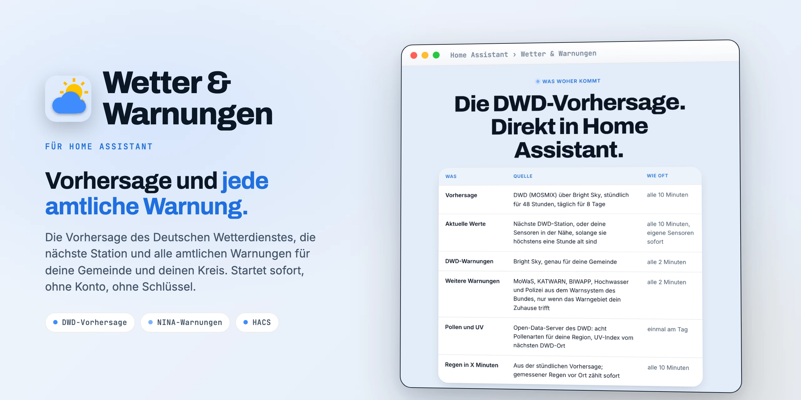

<div align="center">

<picture>
  <source media="(prefers-color-scheme: dark)" srcset="docs/images/readme-title-dark.webp" />
  
</picture>

[](https://github.com/SH1FT-W/wetter-warnungen/releases/latest)
[](https://www.home-assistant.io)
[](https://hacs.xyz)

<a href="https://sh1ft-w.github.io/wetter-warnungen"><b>Website</b></a>&emsp;<a href="#installation">Installation</a>&emsp;<a href="#einrichtung">Einrichtung</a>&emsp;<a href="#entitaeten">Entitäten</a>&emsp;<a href="CHANGELOG.md">Änderungen</a>

</div>

<br/>

Das Wetter an deinem Zuhause in Home Assistant: die **Vorhersage des Deutschen Wetterdienstes**, die Werte der nächsten Station oder deiner eigenen Sensoren und **alle amtlichen Warnungen**, dieselben wie in der NINA-App. Beim Start ist der letzte Stand sofort da. Kein Konto, kein Schlüssel, keine zusätzlichen Python-Pakete.

**Nur für Deutschland:** alle Quellen sind deutsche Dienste, der Deutsche Wetterdienst und das Warnsystem des Bundes.

> [!NOTE]
> Die Warnungen hier ersetzen nicht die offiziellen Warnwege (NINA-App, Radio, Sirenen).

## Was woher kommt

| Was | Quelle | Wie oft |
|:--|:--|:--|
| Vorhersage | DWD (MOSMIX) über [Bright Sky](https://brightsky.dev), stündlich für 48 Stunden, täglich für 8 Tage | alle 10 Minuten |
| Aktuelle Werte | Nächste DWD-Station, oder deine Sensoren in der Nähe, solange sie höchstens eine Stunde alt sind | alle 10 Minuten, eigene Sensoren sofort |
| DWD-Warnungen | Bright Sky, genau für deine Gemeinde | alle 2 Minuten |
| Weitere Warnungen | MoWaS, KATWARN, BIWAPP, Hochwasser und Polizei aus dem Warnsystem des Bundes (NINA), nur wenn das Warngebiet dein Zuhause trifft | alle 2 Minuten |
| Pollen und UV | Open-Data-Server des DWD: acht Pollenarten für deine Region, UV-Index vom nächsten DWD-Ort | einmal am Tag |
| Regen in X Minuten | Aus der stündlichen Vorhersage | alle 10 Minuten |

Ist eine Quelle nicht erreichbar, bleiben ihre letzten Warnungen stehen: **keine falsche Entwarnung**. Abgelaufene Warnungen verschwinden trotzdem pünktlich.

**Neu in 26.11:** Pollenflug und UV-Index, *Regen in X Minuten* und Ereignisse je Warnung; Warnungen der höchsten Stufe erscheinen sofort. Alle Änderungen stehen im [Changelog](CHANGELOG.md).

<a id="installation"></a>
## Installation

[](https://my.home-assistant.io/redirect/hacs_repository/?owner=SH1FT-W&repository=wetter-warnungen&category=integration)

Unter **Einstellungen > Marketplace** (vor Home Assistant 2026.11 heißt er HACS) nach **Wetter & Warnungen** suchen, herunterladen und Home Assistant neu starten.

<details>
<summary>Von Hand installieren</summary>

1. Das [neueste Release](https://github.com/SH1FT-W/wetter-warnungen/releases/latest) herunterladen.
2. Den Ordner `custom_components/wetter` nach `/config/custom_components/` kopieren und Home Assistant neu starten.

</details>

<a id="einrichtung"></a>
## Einrichtung

Du brauchst Home Assistant 2026.9 oder neuer und einen Ort in Deutschland.

1. **Integration hinzufügen.** **Einstellungen > Geräte & Dienste > Integration hinzufügen > Wetter & Warnungen.** Der **Name** gibt den Entitäten ihren Namen („Wetter“ ergibt `weather.wetter`), der **Ort** ist mit dem Zuhause vorbelegt. Die Integration fragt einmal bei Bright Sky nach, ob es dort Daten gibt. Jeder Ort lässt sich nur einmal einrichten.
2. **Werte aus der Nachbarschaft (optional).** Unter **Konfigurieren** nimmt jedes Feld einen vorhandenen Sensor, egal von welchem Hersteller (Ecowitt, Davis, Shelly, Netatmo und andere). Leer bedeutet DWD-Station. Gut geeignet sind Temperatur, Luftfeuchte und Niederschlag der letzten Stunde; Luftdruck nur, wenn er auf Meereshöhe umgerechnet ist, Wind nur von frei stehenden Windmessern. Einen Netatmo-Wetterbereich trägt die Integration selbst ein; andere Sensoren schlägt sie nicht vor, weil sie nicht weiß, ob ein Thermometer draußen hängt.
3. **Pollenflug und UV-Index** sind an. Der Schalter in den Optionen entfernt sie, dann fragt die Integration den DWD-Server dafür nicht mehr.

Den Ort später ändern: **Drei-Punkte-Menü > Neu konfigurieren**. Entitäten, Optionen und Verlauf bleiben.

<a id="entitaeten"></a>
## Entitäten

Alle gehören zu einem Dienst-Gerät je Ort. Die IDs gelten für den Namen **Wetter** auf einer deutschen Installation.

| Entität | Zeigt |
|:--|:--|
| `weather.wetter` | Aktuelles Wetter, Vorhersage über `weather.get_forecasts` |
| `sensor.wetter_temperatur` und weitere | Temperatur, gefühlte Temperatur, Luftfeuchte, Taupunkt, Druck, Wind, Böen, Windrichtung, Niederschlag, Sichtweite, Bewölkung, Wetterzustand. Attribut `source`: DWD oder dein Sensor |
| Regenwahrscheinlichkeit, Regenwahrscheinlichkeit heute | % für die laufende Stunde und für heute, unter 5 % gilt 0 % |
| Sonneneinstrahlung | W/m², Vorhersage der laufenden Stunde |
| `sensor.wetter_warnungen` | Anzahl der gültigen Warnungen. Attribute `area`, `highest_severity`, `warnings` (die schlimmste zuerst), `stale` (Quellen, die zuletzt nicht erreichbar waren) |
| Warnung 1 bis 5 | An = Warnung auf diesem Platz, nach Schwere sortiert. Dieselben Attribute wie die NINA-Integration bis Home Assistant 2026.10 |
| `sensor.wetter_regen_in` | Minuten bis zum nächsten Niederschlag; dazu `binary_sensor.wetter_regen_in_der_nachsten_stunde` |

<details>
<summary>Pollen, UV, Diagnose und die Attribute der Warnungen</summary>

| Entität | Zeigt |
|:--|:--|
| Pollen Ambrosia, Beifuß, Birke, Erle, Esche, Gräser, Hasel, Roggen | Gefahrenindex des DWD für heute, 0 (keine) bis 3 (hohe Belastung) in halben Stufen. Attribute `today`, `tomorrow`, `day_after_tomorrow`, `region` |
| UV-Index, UV-Index morgen | Für den nächsten der 38 DWD-Orte, Bergstationen ausgenommen (Attribut `city`) |
| Quelle (Diagnose) | *Nachbarschaft*, *Gemischt* oder *DWD*, je Wert im Attribut |
| Nachbarschaftsbereich, Fläche, Abstand (Diagnose) | Der Netatmo-Wetterbereich hinter deinen Sensoren: Name, Fläche in km², Abstand seines Mittelpunkts zum Ort |

**Warnung 1 bis 5:** `headline`, `description`, `recommended_actions`, `severity` (Minor bis Extreme), `provider`, `sender`, `sent`, `start`, `expires`, `more_info_url`, `id`, `affected_areas` (bei DWD die Gemeinde, bei NINA das Gebiet aus der Meldung) und immer `region`. NINA hat diese Attribute mit 2026.11 entfernt, hier bleiben sie.

**Regen in:** Attribute `start`, `precipitation` (mm der Stunde), `precipitation_probability`, `source` (`measurement` oder `forecast`).

</details>

## Beispiele

Genau eine Nachricht je neuer Warnung, auch nach einem Neustart nicht doppelt:

```yaml
triggers:
  - trigger: event
    event_type: wetter_warning_new
actions:
  - action: notify.notify
    data:
      title: "{{ trigger.event.data.headline }}"
      message: "{{ trigger.event.data.area }} ({{ trigger.event.data.source }}, Stufe {{ trigger.event.data.severity }})"
mode: queued
```

`wetter_warning_new` und `wetter_warning_ended` tragen `id`, `source` (`DWD` oder `NINA`), `provider`, `severity`, `headline`, `event`, `area`, `start`, `expires` und `entry_id`. Das Ende kommt mit dem Ablauf der Warnung oder, wenn sie 10 Minuten lang in keiner Antwort mehr vorkam; ist eine Quelle nicht erreichbar, kommt kein Ende.

<details>
<summary>Wäsche rein, wenn Regen kommt</summary>

```yaml
triggers:
  - trigger: state
    entity_id: binary_sensor.wetter_regen_in_der_nachsten_stunde
    to: "on"
actions:
  - action: notify.notify
    data:
      message: "Regen in etwa {{ states('sensor.wetter_regen_in') }} Minuten."
```

</details>

<details>
<summary>Höchstwert und Regenrisiko heute als Ansage</summary>

```yaml
- action: weather.get_forecasts
  target:
    entity_id: weather.wetter
  data:
    type: daily
  response_variable: vorhersage
- action: tts.speak
  data:
    message: >-
      Heute bis {{ vorhersage['weather.wetter'].forecast[0].temperature | round }} Grad,
      Regenrisiko {{ vorhersage['weather.wetter'].forecast[0].precipitation_probability }} Prozent.
```

</details>

<details>
<summary>Push bei jeder neuen Warnung ohne Ereignis, aus der Warnliste</summary>

```yaml
triggers:
  - trigger: state
    entity_id: sensor.wetter_warnungen
    attribute: warnings
conditions:
  - condition: template
    value_template: "{{ trigger.from_state is not none and trigger.from_state.state not in ['unknown', 'unavailable'] }}"
variables:
  alte_ids: "{{ (trigger.from_state.attributes.warnings or []) | map(attribute='id') | list }}"
  neu: "{{ (trigger.to_state.attributes.warnings or []) | rejectattr('id', 'in', alte_ids) | list }}"
actions:
  - repeat:
      for_each: "{{ neu }}"
      sequence:
        - action: notify.notify
          data:
            title: "{{ repeat.item.headline }}"
            message: "{{ repeat.item.description }}"
mode: queued
```

</details>

## Deine Daten

- **Kein Konto, kein Schlüssel.** Alle Quellen sind öffentlich.
- **Die Koordinaten des Orts** gehen an Bright Sky und einmalig an den Geodienst des DWD (für die Pollenregion), auf vier Nachkommastellen gerundet.
- **Die Diagnose schwärzt** Koordinaten und Warngebiet. Die Warntexte selbst können Orte nennen.

## Gut zu wissen

- Die Vorhersage gilt für den nächsten DWD-Vorhersagepunkt, meist wenige Kilometer entfernt. Die Messstation kann weit weg sein; dafür gibt es die Werte aus der Nachbarschaft.
- *Regen in* ist nur so genau wie die stündliche Vorhersage: Regen gilt ab Beginn der ersten Stunde mit mindestens 0,1 mm. Kein Regenradar, keine Luftqualität.
- Lässt sich das Warngebiet einer neuen Kreis-Meldung nicht laden, wartet die Integration bis zu 5 Minuten und zeigt sie dann für den ganzen Kreis. Meldungen der höchsten Stufe (*Extreme*) erscheinen sofort.
- Aktualisiert der DWD eine Warnung, bekommt sie oft eine neue Kennung. Das ergibt ein Ende- und ein Neu-Ereignis.
- Liegt der Ort außerhalb der 27 Pollenregionen oder weiter als 200 km von einem UV-Ort, bleiben diese Sensoren unbekannt.

<a id="fehlersuche"></a>
<details>
<summary>Fehlersuche</summary>

- **Werte bleiben auf DWD, obwohl Sensoren eingetragen sind.** Sensor *Quelle* ansehen. Ist dein Sensor nicht verfügbar oder älter als eine Stunde, gilt DWD. Netatmo-Wetterbereiche brauchen nach einem Neustart oft einige Minuten.
- **Keine Meldungen für den Kreis.** Attribut `area` des Sensors *Warnungen* prüfen; der Kreis wird aus der DWD-Warnzelle der Gemeinde abgeleitet.
- **Debug-Protokoll:** **Drei-Punkte-Menü > Debug-Protokollierung aktivieren** oder:

  ```yaml
  logger:
    logs:
      custom_components.wetter: debug
  ```

Wenn du ein [Issue](https://github.com/SH1FT-W/wetter-warnungen/issues) öffnest, häng bitte die Diagnose an (**Drei-Punkte-Menü > Diagnose herunterladen**).

</details>

<details>
<summary>Entfernen</summary>

1. **Einstellungen > Geräte & Dienste > Wetter & Warnungen > Drei-Punkte-Menü > Löschen.** Die gespeicherten Stände werden mitgelöscht.
2. Das Repository im Marketplace entfernen (oder `/config/custom_components/wetter` löschen) und Home Assistant neu starten.

</details>

<details>
<summary>So funktioniert es</summary>

- **Start ohne Warten.** Der letzte Stand kommt aus dem Speicher, die erste Abfrage erst, wenn Home Assistant fertig gestartet ist. Gespeichert wird nur, wenn sich etwas geändert hat.
- **Warnungen.** DWD-Meldungen aus NINA werden übersprungen, weil sie schon gemeindegenau von Bright Sky kommen. Kreis-Meldungen werden gegen ihr Warngebiet geprüft, gut 1 km Rand zählt mit. Volltexte und Warngebiete lädt die Integration nur für neue oder geänderte Meldungen.
- **Regen in.** Bei gemessenem Regen der letzten Stunde (dein Sensor oder die Station) steht 0, sonst zählt die erste nasse Vorhersagestunde der nächsten 48 Stunden. Ohne Regen in 48 Stunden: unbekannt.
- **Pollen und UV.** Der DWD veröffentlicht einmal am Tag. Die Integration prüft stündlich und lädt nur, wenn neue Dateien fällig sind; um Mitternacht rückt morgen auf heute. Ein Ausfall des DWD-Servers lässt die letzten Werte stehen.
- **Gefühlte Temperatur** rechnet die Integration selbst (Steadman-Formel wie Open-Meteo), der DWD liefert sie nicht.

Datenquellen und ihre Bedingungen stehen in [`NOTICE`](NOTICE). Domain und Ordner heißen `wetter`.

</details>

<details>
<summary>Entwicklung</summary>

```bash
.venv/bin/python -m pytest -q -p no:logging --cov=custom_components   # fiktive Daten in tests/fixtures
uvx ruff check . && uvx ruff format --check .
uvx mypy@2.3.1 --python-executable .venv/bin/python
.venv/bin/python tools/pruefe-uebersetzungen.py    # strings.json gegen translations/*.json
```

Testpakete: `uv venv && uv pip install -r requirements_test.txt pytest-cov`. Die Tests fragen keinen Server ab. Der Snapshot-Test (`tests/test_snapshot.py`) hält alle Entitäten fest; gewollte Änderungen mit `--snapshot-update` übernehmen. GitHub Actions prüft bei jedem Push und wöchentlich gegen das neueste Home Assistant, dazu HACS-Prüfung und hassfest. Quality Scale: Platin, [selbst geprüft](custom_components/wetter/quality_scale.yaml).

</details>

## Lizenz

[Apache License 2.0](LICENSE), Copyright 2026 SH1FT-W. Wetterdaten und DWD-Warnungen: Quelle Deutscher Wetterdienst, CC BY 4.0, siehe [`NOTICE`](NOTICE).

<sub>Wetter &amp; Warnungen ist ein unabhängiges Projekt. Es gehört weder zum Deutschen Wetterdienst, zum Bundesamt für Bevölkerungsschutz und Katastrophenhilfe (BBK) noch zu Bright Sky und wird von ihnen nicht unterstützt.</sub>
