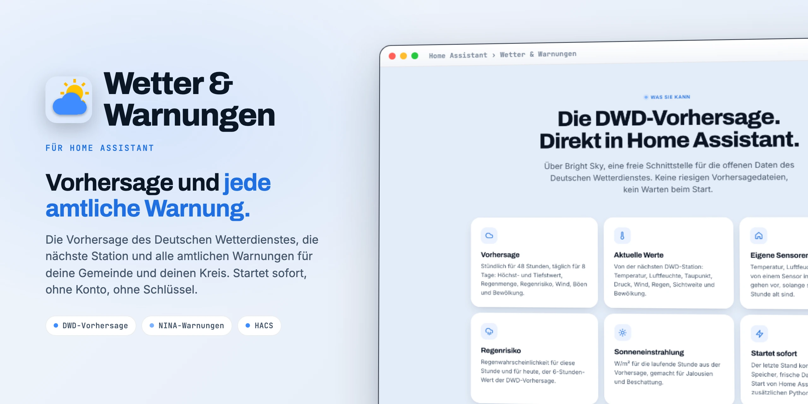

<div align="center">

<picture>
  <source media="(prefers-color-scheme: dark)" srcset="docs/images/readme-title-dark.webp" />
  
</picture>

<p>Die Vorhersage des <b>Deutschen Wetterdienstes</b>, die nächste Station und <b>alle amtlichen Warnungen</b> in Home Assistant.<br/>
Startet sofort. Ohne Konto, ohne Schlüssel, ohne zusätzliche Pakete.</p>

[](https://github.com/SH1FT-W/wetter-warnungen/releases/latest)
[](https://www.home-assistant.io)
[](https://hacs.xyz)
[](https://developers.home-assistant.io/docs/creating_integration_manifest/#iot-class)
[-3D8BFF?style=flat-square&labelColor=111111)](custom_components/wetter/quality_scale.yaml)
[](LICENSE)

<p><a href="https://sh1ft-w.github.io/wetter-warnungen"><b>Website</b></a> &nbsp;·&nbsp; <a href="#funktionen">Funktionen</a> &nbsp;·&nbsp; <a href="#entitaeten">Entitäten</a> &nbsp;·&nbsp; <a href="#installation">Installation</a> &nbsp;·&nbsp; <a href="#optionen">Optionen</a> &nbsp;·&nbsp; <a href="#fehlersuche">Fehlersuche</a> &nbsp;·&nbsp; <a href="CHANGELOG.md">Änderungen</a></p>

</div>

<br/>

Wetter &amp; Warnungen holt das Wetter an deinem Zuhause nach Home Assistant: die **Vorhersage des Deutschen Wetterdienstes** (MOSMIX) über [Bright Sky](https://brightsky.dev), die **aktuellen Werte der nächsten DWD-Station** und **alle amtlichen Warnungen**: DWD-Warnungen genau für deine Gemeinde, dazu Bevölkerungsschutz (MoWaS), KATWARN, BIWAPP, Hochwasser und Polizei für deinen Kreis aus dem Warnsystem des Bundes, dieselben Daten wie in der NINA-App.

Schnell und schlank: Beim Start ist der letzte Stand sofort da, frische Daten kommen, sobald Home Assistant fertig gestartet ist. Kein Konto, kein Schlüssel, keine zusätzlichen Python-Pakete. **Nur für Deutschland.**

> [!NOTE]
> Wetter &amp; Warnungen ist ein unabhängiges Projekt. Es gehört weder zum Deutschen Wetterdienst, zum Bundesamt für Bevölkerungsschutz und Katastrophenhilfe (BBK) noch zu Bright Sky und wird von ihnen nicht unterstützt. Wetterdaten und DWD-Warnungen: Quelle Deutscher Wetterdienst, CC BY 4.0. Die Warnungen hier ersetzen nicht die offiziellen Warnwege (NINA-App, Radio, Sirenen).

<a id="funktionen"></a>
## Funktionen

<!-- cards:features -->
<table>
<tr><td width="50%" valign="top"><picture><source media="(prefers-color-scheme: dark)" srcset="docs/images/icons/weather-partly-rainy-dark.svg"></picture> <b>DWD-Vorhersage</b><br>MOSMIX-Vorhersage des Deutschen Wetterdienstes: stündlich für 48 Stunden, täglich für 8 Tage, mit Höchst- und Tiefstwert, Regenmenge, Regenrisiko, Wind, Böen und Bewölkung.</td><td width="50%" valign="top"><picture><source media="(prefers-color-scheme: dark)" srcset="docs/images/icons/thermometer-dark.svg"></picture> <b>Aktuelle Werte</b><br>Gemessen an der nächsten DWD-Station. Lücken füllt die Vorhersage der laufenden Stunde.</td></tr>
<tr><td width="50%" valign="top"><picture><source media="(prefers-color-scheme: dark)" srcset="docs/images/icons/home-thermometer-outline-dark.svg"></picture> <b>Eigene Sensoren zuerst</b><br>Temperatur, Luftfeuchte und Regen von einem Sensor in der Nähe (Ecowitt, Davis, Shelly, Netatmo und andere) gehen vor, solange sie höchstens eine Stunde alt sind.</td><td width="50%" valign="top"><picture><source media="(prefers-color-scheme: dark)" srcset="docs/images/icons/alert-outline-dark.svg"></picture> <b>Alle amtlichen Warnungen</b><br>DWD-Warnungen für deine Gemeinde, dazu MoWaS, KATWARN, BIWAPP, Hochwasser und Polizei für deinen Kreis, alle 2 Minuten abgefragt.</td></tr>
<tr><td width="50%" valign="top"><picture><source media="(prefers-color-scheme: dark)" srcset="docs/images/icons/shield-check-outline-dark.svg"></picture> <b>Keine falsche Entwarnung</b><br>Ist eine Quelle nicht erreichbar, bleiben ihre letzten Warnungen stehen. Abgelaufene Warnungen verschwinden trotzdem pünktlich.</td><td width="50%" valign="top"><picture><source media="(prefers-color-scheme: dark)" srcset="docs/images/icons/rocket-launch-outline-dark.svg"></picture> <b>Startet sofort</b><br>Der letzte Stand kommt aus dem Speicher, frische Daten erst nach dem Start von Home Assistant. Ohne Konto, ohne Schlüssel, ohne zusätzliche Python-Pakete.</td></tr>
</table>
<!-- /cards:features -->

- **Vorhersage** des Deutschen Wetterdienstes (MOSMIX) über Bright Sky: stündlich für 48 Stunden, täglich für 8 Tage (Höchst- und Tiefstwert, Regenmenge, Regenrisiko, Wind, Böen, Bewölkung).
- **Aktuelle Werte** der nächsten DWD-Station. Temperatur, Luftfeuchte und Regen können stattdessen von **eigenen Sensoren in der Nähe** kommen, zum Beispiel von einer Wetterstation oder einem Netatmo-Wetterbereich, solange diese Werte frisch sind.
- **Alle amtlichen Warnungen**: DWD genau für die Gemeinde, dazu Bevölkerungsschutz (MoWaS), KATWARN, BIWAPP, Hochwasser (LHP) und Polizei für den Kreis aus dem Warnsystem des Bundes (NINA). Kreis-Meldungen erscheinen nur, wenn ihr Warngebiet das Zuhause wirklich trifft (gut 1 km Rand eingerechnet).
- **Keine falsche Entwarnung**: Ist eine Quelle nicht erreichbar, bleiben ihre letzten Warnungen stehen. Abgelaufene Warnungen verschwinden trotzdem pünktlich.
- **Start ohne Warten**: letzter Stand sofort aus dem Speicher, frische Daten erst, wenn Home Assistant fertig gestartet ist.
- Kein Konto, kein Schlüssel, keine zusätzlichen Python-Pakete. Deutsch und Englisch.

<a id="entitaeten"></a>
## Entitäten

<!-- cards:entities -->
<table>
<tr><td width="50%" valign="top"><picture><source media="(prefers-color-scheme: dark)" srcset="docs/images/icons/weather-partly-cloudy-dark.svg"></picture> <b>Wetter-Entität</b><br>Aktuelles Wetter mit Vorhersage stündlich (48 Std.) und täglich (8 Tage) über weather.get_forecasts.</td><td width="50%" valign="top"><picture><source media="(prefers-color-scheme: dark)" srcset="docs/images/icons/thermometer-lines-dark.svg"></picture> <b>Messwerte</b><br>Temperatur, gefühlte Temperatur, Luftfeuchte, Taupunkt, Druck, Wind, Böen, Windrichtung, Niederschlag, Sichtweite, Bewölkung und Wetterzustand.</td></tr>
<tr><td width="50%" valign="top"><picture><source media="(prefers-color-scheme: dark)" srcset="docs/images/icons/umbrella-outline-dark.svg"></picture> <b>Regen und Sonne</b><br>Regenwahrscheinlichkeit für diese Stunde und für heute, Sonneneinstrahlung in W/m² aus der Vorhersage.</td><td width="50%" valign="top"><picture><source media="(prefers-color-scheme: dark)" srcset="docs/images/icons/alert-circle-outline-dark.svg"></picture> <b>Warnungen</b><br>Ein Zähler mit allen Warnungen als Attribut, die schlimmste zuerst, und Warnung 1 bis 5 mit denselben Attributen wie die NINA-Integration.</td></tr>
<tr><td width="50%" valign="top"><picture><source media="(prefers-color-scheme: dark)" srcset="docs/images/icons/map-marker-radius-outline-dark.svg"></picture> <b>Nachbarschaft</b><br>Woher die aktuellen Werte kommen, dazu Bereich, Fläche, Abstand und ein Radius-Regler für einen Netatmo-Wetterbereich.</td><td width="50%" valign="top"><picture><source media="(prefers-color-scheme: dark)" srcset="docs/images/icons/stethoscope-dark.svg"></picture> <b>Diagnose</b><br>Herunterladen mit geschwärzten Koordinaten und geschwärztem Warngebiet.</td></tr>
</table>
<!-- /cards:entities -->

Alle Entitäten gehören zu einem Dienst-Gerät je Ort. Die Beispiele gelten für den vorgegebenen Namen **Wetter** auf einer deutschen Installation (`weather.wetter`, `sensor.wetter_temperatur`, …).

| Entität | Inhalt |
|---|---|
| `weather.wetter` | Aktuelles Wetter und Vorhersage stündlich (48 Std.) und täglich (8 Tage) über `weather.get_forecasts` |
| Temperatur, Relative Luftfeuchtigkeit, Taupunkt, Druck | Aktuelle Werte; Attribut `source` (`dwd` oder der Nachbarschaftssensor) |
| Gefühlte Temperatur | Aus Temperatur, Luftfeuchte und Wind gerechnet (Steadman-Formel wie bei Open-Meteo), auch in der Vorhersage; Nachbarschaftswerte zählen mit |
| Windgeschwindigkeit, Windböen, Windrichtung | km/h bzw. Grad |
| Niederschlag | mm/h der letzten Stunde |
| Regenwahrscheinlichkeit, Regenwahrscheinlichkeit heute | % für die laufende Stunde bzw. für heute (6-Stunden-Wahrscheinlichkeit der DWD-Vorhersage, wie in der Tagesvorhersage) |
| Sonneneinstrahlung | W/m², Vorhersage der laufenden Stunde (die Station misst sie nicht) |
| Sichtweite, Bewölkungsgrad, Wetterzustand | |
| Nachbarschaftsbereich, Nachbarschaft Fläche, Nachbarschaft Abstand (Diagnose) | Netatmo-Wetterbereich hinter den eingetragenen Sensoren: Name (Attribute Breite und Höhe), Fläche in km², Abstand seines Mittelpunkts zum Ort. Die Zahl der Stationen gibt Netatmo nicht heraus. |
| Nachbarschaft Radius (Konfiguration) | Regler 1 bis 20 km, nur mit Netatmo-Wetterbereich, siehe [unten](#radius) |
| Quelle (Diagnose) | *Nachbarschaft*, *Gemischt* oder *DWD*: woher die aktuellen Werte gerade kommen, je Wert im Attribut |
| Warnungen | Anzahl der gültigen Warnungen; Attribute `area` (Warngebiet), `highest_severity`, `warnings` (alle Warnungen, die schlimmste zuerst) und `stale` (Quellen, die zuletzt nicht erreichbar waren) |
| Warnung 1 … 5 | An = Warnung auf diesem Platz (nach Schwere sortiert). Attribute wie bei der NINA-Integration: `headline`, `description`, `recommended_actions`, `severity` (Minor … Extreme), `provider`, `sender`, `sent`, `start`, `expires`, `more_info_url`, `id`, dazu immer `region` (Warngebiet kurz, z. B. für „keine Warnungen für …“) |

**Aktualisierung:**

- Wetter alle **10 Minuten**: aktuelle Messung und stündliche Vorhersage (zusammen etwa 80 KB, etwa 0,1 s).
- Warnungen alle **2 Minuten**: DWD-Warnungen der Gemeinde (Bright Sky) und Meldungen für den Kreis (NINA). Volltexte und Warngebiete nur für neue oder geänderte Meldungen.
- Gespeichert wird der Stand nur, wenn sich Messung, Vorhersage oder Warnungen geändert haben.
- Nachbarschaftswerte sofort bei jeder Änderung des Sensors.
- Beim Start: letzter gespeicherter Stand sofort, Abfragen erst nach dem Start von Home Assistant.

<a id="installation"></a>
## Installation

**Voraussetzungen:** Home Assistant 2026.9 oder neuer und ein Ort in Deutschland.

### HACS (benutzerdefiniertes Repository)

1. In HACS das Drei-Punkte-Menü öffnen, **Benutzerdefinierte Repositories** wählen und `https://github.com/SH1FT-W/wetter-warnungen` mit dem Typ **Integration** hinzufügen.
2. Nach **Wetter & Warnungen** suchen, herunterladen und Home Assistant neu starten.

### Von Hand

1. Das [neueste Release](https://github.com/SH1FT-W/wetter-warnungen/releases/latest) herunterladen.
2. Den Ordner `custom_components/wetter` nach `/config/custom_components/` kopieren und Home Assistant neu starten.

## Einrichtung

**Einstellungen > Geräte & Dienste > Integration hinzufügen > Wetter & Warnungen.**

| Feld | Bedeutung |
|---|---|
| Name | Name des Geräts; die Entitäten heißen danach, z. B. „Wetter“ ergibt `weather.wetter` |
| Ort | Punkt für Vorhersage und Warnungen, vorbelegt mit dem Zuhause. Bright Sky nimmt den nächsten DWD-Vorhersagepunkt und die nächste Messstation. |

Vor dem Anlegen fragt die Integration einmal bei Bright Sky nach, ob es für den Ort Daten gibt. Derselbe Ort lässt sich nur einmal einrichten. Den Ort später ändern: **Drei-Punkte-Menü > Neu konfigurieren** (Entitäten, Optionen und Verlauf bleiben).

<a id="optionen"></a>
## Optionen: Werte aus der Nachbarschaft

**Einstellungen > Geräte & Dienste > Wetter & Warnungen > Konfigurieren.** Jedes Feld nimmt einen vorhandenen Sensor, **egal von welchem Hersteller**: eigene Wetterstation (Ecowitt, Davis, Shelly, Netatmo-Außenmodul, …), ein Außenthermometer oder ein Netatmo-Wetterbereich. Leer = DWD-Station.

**Automatisch:** Gibt es in der Netatmo-Integration einen Wetterbereich (öffentliche Stationen, *Netatmo > Konfigurieren*), trägt Wetter &amp; Warnungen beim Einrichten dessen Temperatur, Luftfeuchte und Niederschlag selbst ein und schlägt sie in leeren Optionen vor (bei mehreren Bereichen den nächstgelegenen). Andere Sensoren schlägt die Integration nicht vor: Sie kann nicht sicher erkennen, ob ein Thermometer draußen hängt.

| Option | Geeignet | Hinweis |
|---|---|---|
| Temperatur | ja | |
| Luftfeuchtigkeit | ja | |
| Niederschlag (letzte Stunde) | ja | Regen vor Ort ändert auch das Wettersymbol (Regen oder bewölkt, Gewitter ohne Regen zeigt Gewitter); Schnee, Schneeregen und Hagel bleiben, die misst ein Regenmesser nicht zuverlässig |
| Luftdruck | selten | Nur Druck auf Meereshöhe; Netatmo-Bereiche liefern den nicht zuverlässig |
| Windgeschwindigkeit / Böen | selten | Nur frei stehende Windmesser; geschützte Stationen messen viel zu wenig |

Ein Nachbarschaftswert gilt, solange er höchstens eine Stunde alt und lesbar ist. Sonst nimmt die Integration wieder den DWD-Wert und wechselt sofort zurück, sobald der Sensor wieder liefert.

<a id="radius"></a>
### Nachbarschaft Radius (nur Netatmo)

Kommen die Nachbarschaftssensoren aus einem **Netatmo-Wetterbereich**, legt die Integration den Regler **Nachbarschaft Radius** an (1 bis 20 km). Ein neuer Wert **schreibt einen neuen Bereich in die Optionen der Netatmo-Integration**: ein Quadrat um den Ort mit dem gewählten Radius als halber Kantenlänge, so wie es der Optionsdialog von Netatmo selbst tut. Die übrigen Einstellungen des Bereichs bleiben. Netatmo lädt danach neu, die Werte kommen nach einigen Minuten wieder.

Ohne Netatmo-Wetterbereich gibt es den Regler nicht. Verschwindet der Bereich später, ist der Regler nicht verfügbar und tut nichts.

## Beispiele

Push bei jeder neuen Warnung (Vergleich der Warnliste nach Kennung, Umsortieren löst nichts aus):

```yaml
triggers:
  - trigger: state
    entity_id: sensor.wetter_warnungen
    attribute: warnings
conditions:
  - condition: template
    value_template: "{{ trigger.from_state is not none and trigger.from_state.state not in ['unknown', 'unavailable'] }}"
variables:
  alte_ids: "{{ (trigger.from_state.attributes.warnings or []) | map(attribute='id') | list }}"
  neu: "{{ (trigger.to_state.attributes.warnings or []) | rejectattr('id', 'in', alte_ids) | list }}"
actions:
  - repeat:
      for_each: "{{ neu }}"
      sequence:
        - action: notify.notify
          data:
            title: "{{ repeat.item.headline }}"
            message: "{{ repeat.item.description }}"
mode: queued
```

Höchstwert und Regenrisiko heute als Ansage:

```yaml
- action: weather.get_forecasts
  target:
    entity_id: weather.wetter
  data:
    type: daily
  response_variable: vorhersage
- action: tts.speak
  data:
    message: >-
      Heute bis {{ vorhersage['weather.wetter'].forecast[0].temperature | round }} Grad,
      Regenrisiko {{ vorhersage['weather.wetter'].forecast[0].precipitation_probability }} Prozent.
```

Typische Einsätze: Jalousien bei starker Sonne (*Sonneneinstrahlung* über 300 W/m²), Bewässerung aussetzen bei Regenrisiko, Warn-Kachel im Dashboard (*Warnung 1* an), Tagesübersicht per Sprachausgabe.

## Grenzen

- Die Vorhersage gilt für den nächsten DWD-Vorhersagepunkt (meist wenige Kilometer entfernt), nicht genau für die Adresse.
- Die DWD-Messstation kann weit weg sein; dafür gibt es die Nachbarschaftswerte.
- Meldungen für den Kreis (MoWaS und andere) kommen kreisweise aus NINA; angezeigt werden nur die, deren Warngebiet das Zuhause trifft (gut 1 km Rand zählt mit). Lässt sich das Gebiet nicht laden, gilt der ganze Kreis. DWD-Warnungen gelten für die Gemeinde.
- Keine Pollen, kein Regenradar, keine Luftqualität.
- **Nur Deutschland** (DWD und Warnsystem des Bundes).

<a id="fehlersuche"></a>
## Fehlersuche

- **Werte bleiben auf DWD, obwohl Nachbarschaftssensoren eingetragen sind:** Sensor *Quelle* ansehen. Ist der Nachbarschaftssensor `nicht verfügbar` oder älter als eine Stunde, gilt DWD. Netatmo-Wetterbereiche brauchen nach einem Neustart oft einige Minuten.
- **Keine Meldungen für den Kreis:** Attribut `area` des Sensors *Warnungen* prüfen; der Kreis wird aus der DWD-Warnzelle der Gemeinde abgeleitet.
- **Diagnose:** **Drei-Punkte-Menü > Diagnose herunterladen**. Koordinaten und Warngebiet sind geschwärzt; die Warntexte selbst können Orte nennen.
- **Debug-Protokoll:** **Drei-Punkte-Menü > Debug-Protokollierung aktivieren** oder:

  ```yaml
  logger:
    logs:
      custom_components.wetter: debug
  ```

Wenn du ein [Issue](https://github.com/SH1FT-W/wetter-warnungen/issues) öffnest, häng bitte die Diagnose an.

## Entfernen

1. **Einstellungen > Geräte & Dienste > Wetter & Warnungen > Drei-Punkte-Menü > Löschen.** Dabei werden auch die gespeicherten Stände gelöscht.
2. Den Ordner `/config/custom_components/wetter` löschen (oder das Repository in HACS entfernen) und Home Assistant neu starten.

## So funktioniert es

<!-- cards:how -->
<table>
<tr><td width="33%" valign="top"><picture><source media="(prefers-color-scheme: dark)" srcset="docs/images/icons/weather-cloudy-clock-dark.svg"></picture> <b>Bright Sky</b><br>Vorhersage, Stationswerte und DWD-Warnungen aus der freien Bright-Sky-Schnittstelle für die offenen Daten des DWD, alle 10 Minuten.</td><td width="33%" valign="top"><picture><source media="(prefers-color-scheme: dark)" srcset="docs/images/icons/bullhorn-outline-dark.svg"></picture> <b>Warnsystem des Bundes</b><br>Die übrigen amtlichen Warnungen für deinen Kreis von warnung.bund.de, dieselben Daten wie in der NINA-App, alle 2 Minuten.</td><td width="33%" valign="top"><picture><source media="(prefers-color-scheme: dark)" srcset="docs/images/icons/home-outline-dark.svg"></picture> <b>Deine Nachbarschaft</b><br>Sensoren aus den Optionen gehen vor, solange sie frisch sind. Sonst gilt der Wert des DWD.</td></tr>
</table>
<!-- /cards:how -->

Vorhersage, aktuelle Werte und DWD-Warnungen kommen von [Bright Sky](https://brightsky.dev), einer freien JSON-Schnittstelle für die offenen Daten des Deutschen Wetterdienstes. Die übrigen Warnungen kommen aus der öffentlichen Warn-Schnittstelle des BBK ([warnung.bund.de](https://warnung.bund.de)); der Kreis ergibt sich aus der DWD-Warnzelle der Gemeinde, DWD-Meldungen aus NINA werden übersprungen, weil sie schon von Bright Sky kommen. Datenquellen und ihre Bedingungen stehen in [`NOTICE`](NOTICE).

Die Domain ist `wetter`, der Ordner `custom_components/wetter`. Interne Notizen stehen in [`CLAUDE.md`](CLAUDE.md).

## Entwicklung

```bash
.venv/bin/python -m pytest -q -p no:logging --cov=custom_components   # fiktive Daten in tests/fixtures
uvx ruff check . && uvx ruff format --check .
uvx mypy@2.3.1 --python-executable .venv/bin/python
.venv/bin/python tools/pruefe-uebersetzungen.py    # strings.json gegen translations/*.json
```

Testpakete mit `uv venv && uv pip install -r requirements_test.txt pytest-cov` installieren. Die Tests fragen weder Bright Sky noch die Warn-Schnittstelle ab. Dieselben Prüfungen laufen auf GitHub Actions bei jedem Push und Pull Request und wöchentlich gegen das neueste Home Assistant, dazu HACS-Prüfung und hassfest. Selbsteinschätzung der [Integration Quality Scale](https://developers.home-assistant.io/docs/core/integration-quality-scale/): [`quality_scale.yaml`](custom_components/wetter/quality_scale.yaml).

## Lizenz

[Apache License 2.0](LICENSE), Copyright 2026 SH1FT-W. Wetterdaten: Deutscher Wetterdienst (CC BY 4.0), siehe [`NOTICE`](NOTICE).
